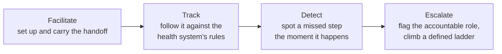

# Welcome to Sygnal

Health systems run on many digital platforms: clinic records, community health worker apps, hospital management systems, labs, pharmacies and health information exchanges. Most of them can already share records. Few of them share **what should happen next**: that a referral was made, that it was accepted, that a follow-up is due, or that it never happened.

**Sygnal is an open enabler of Care Coordination Networks.** A Care Coordination Network is a network of independent health platforms that hand off care to one another, follow each handoff through, and spot what falls through the gaps. They do this without building point-to-point integrations, and without a central system that holds patient records or makes clinical decisions.

Sygnal provides what such a network needs:

| | What it is | Where to read more |
|---|---|---|
| **Specifications** | The Sygnal coordination protocol. It builds on [Beckn Protocol v2](https://github.com/beckn/protocol-specifications-v2) and adds the APIs, schemas, code lists, policies and conventions that coordination needs. | [Specification](specification/README.md) |
| **Edge tools** | The **Sygnal Edge Adapter**, which lets a platform join a network with a small integration instead of a rebuild. | [Edge Adapter](components/edge-adapter.md) |
| **Network enablement services** | Shared services that run the network: **Network Registry**, **Discovery Service**, **Policy Manager**, **Deviation & Escalation Platform** and **Network Intelligence**. | [Components](components/README.md) |

These come in three forms. The **Sygnal Protocol** is the open specification. The **Sygnal Platform** is software that implements it. It is being prepared for open-source release. **Sygnal Network Services** are the shared services, hosted and operated so that a network can start without running them itself. They handle coordination metadata only, never patient records. See [Protocol, platform and services](concepts/protocol-platform-services.md).

## The idea in one paragraph

Sygnal helps two platforms set up a coordination promise, such as a referral, a follow-up or a task. It carries the promise directly between them so that both sides agree it happened, and then follows it against the rules the health system has set. When the promise breaks, Sygnal sends a flag to the system used by whoever is accountable for closing it. If it stays open, Sygnal escalates it. The shared services see coordination metadata only, never the clinical record. **The centre observes and signals; it never decides.**

## Where to start

* **New to Sygnal?** Read [The coordination gap](why-sygnal/README.md), then [How Sygnal helps](why-sygnal/how-sygnal-helps.md).
* **Architects and policy makers:** start with [Architecture](concepts/architecture.md), [Design principles](concepts/design-principles.md) and [Privacy and data minimisation](concepts/privacy-and-data-minimisation.md).
* **Implementers:** go to [Build and join](build/README.md), the [Specification](specification/README.md) and the worked [Use cases](use-cases/README.md). To try it with other platforms, join the [Sygnal Sandbox](build/sandbox.md).

## Status


**Sygnal is in active development.** The specification is a public **draft (v0.9)** and may change in breaking ways before v1.0. The reference components are at different stages; see [Status and roadmap](roadmap.md). We welcome review and contributions: see [How to give feedback](reference/feedback.md) and [Contributing](reference/contributing.md).


## Licence

The Sygnal specification and documentation are published under [CC BY-SA 4.0](https://creativecommons.org/licenses/by-sa/4.0/). You may share and adapt them, including commercially, with attribution; adapted versions must be shared under the same licence. The licence for reference code (such as the validator) is still to be decided. Sygnal is an open initiative led by Medtronic LABS. See [About Sygnal](reference/about.md).
