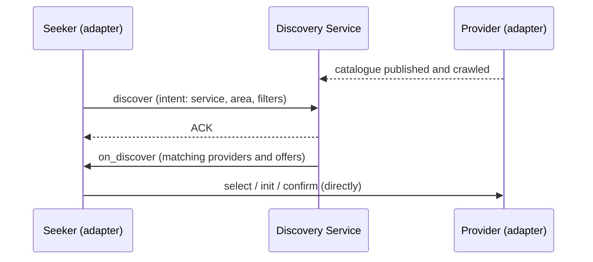

# Discovery Service

The **Discovery Service** lets a seeking platform find the services and providers it could hand off to. It is used for **matched** transitions, where the receiver isn't known in advance. Examples are a clinic looking for a campaign with field reach in an area, or a coordinator looking for a facility that can take an escalation. Directed handoffs skip it.

## How it works

1. **Providers publish catalogues.** Each provider describes what it offers (services, coverage, capacity) as a Beckn catalogue. Providers publish catalogues as signed files, and each provider's registry record says where its files are. The Discovery Service crawls (fetches) the catalogues from those locations. Providers can also push a catalogue directly, as an optional way to speed this up.
2. **Seekers discover.** A seeker sends a Beckn `discover` request through its adapter, with an intent that says what it is looking for. That intent can be a text search, a filter, or a spatial query such as "within 5 km".
3. **Results come back asynchronously.** The Discovery Service later sends its answer, `on_discover`, as a separate message to the seeker's callback address.
4. **The seeker chooses.** The seeker, or a person using it, selects a provider and continues with `select` / `init` / `confirm` **directly with that provider**. The Discovery Service is not part of the transaction.

## Design notes

* **Filters use RFC 9535 JSONPath**, the same expression grammar used elsewhere in Sygnal.
* **Discovery requests carry no personal information.** Discovery is a broadcast, so no patient context is ever included.
* **The Discovery Service shows options; it never decides.** It returns candidates. The choice stays with the seeking platform or a person.
* **Later: coordination-aware ranking.** Discovery could rank providers using coordination signals, such as certification tier, protocol version or loop-closure record, computed from metadata only.

## Implementation

Discovery in Beckn v2 is **decentralised**. Any network, or any operator, can run a discovery service over the catalogues participants publish. Sygnal runs **its own instance** of [Beckn's open-source discovery service](https://github.com/beckn/beckn-discovr), with a catalogue crawler and an HTTPS gateway. Other operators can run their own, and a network of networks can link several.

## Protocol, platform and network services

| Protocol | Platform | Network Services |
|---|---|---|
| Beckn `discover` / `on_discover` and catalogue publishing | Beckn's open-source discovery service, used as published | A Sygnal-operated discovery instance, in use on the Sygnal Sandbox |

See [Protocol, platform and services](../concepts/protocol-platform-services.md).

## Status


**In use on the [Sygnal Sandbox](../build/sandbox.md).** Working: text, filter and spatial discovery; catalogue crawling; asynchronous `on_discover`. Needed before production use: signature verification on incoming requests, **signed** `on_discover` callbacks, Ed25519 verification of crawled catalogues, and callback addressing resolved from the registry.

