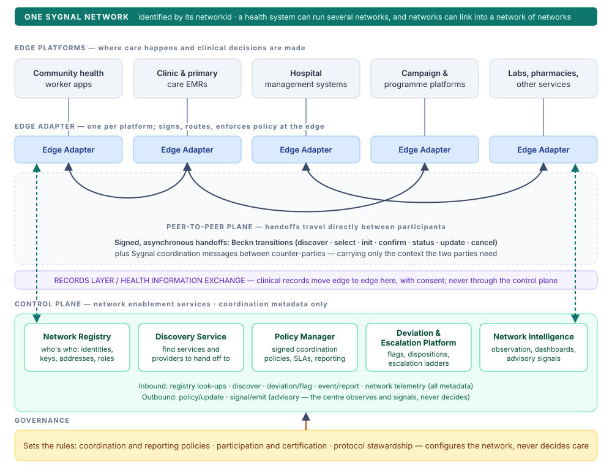
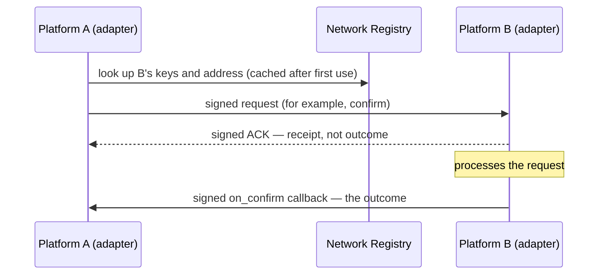

# Architecture

Sygnal follows the pattern behind the most successful digital public infrastructure: a **thin centre and thick edges**, built on **protocols rather than platforms**. Coordination runs directly between the platforms that deliver care. A small set of shared services makes the network work and makes it visible, without becoming a hub that every message must pass through.

The diagram shows the architecture of **one Sygnal network**. A health system can run several networks, and networks can be linked into a network of networks (see [Care Coordination Networks](care-coordination-networks.md#networks-are-plural)).

## The layers

| Layer | What it is | Sygnal components |
|---|---|---|
| **Edge platforms** | The existing systems where care happens and clinical decisions are made: EMRs, hospital systems, community health worker apps, campaign platforms, labs, pharmacies. Sygnal doesn't replace them. | — |
| **Edge adapter** | A thin layer beside each platform that speaks the protocol on its behalf. It signs and verifies messages, routes them, runs service-level agreement (SLA) timers, and enforces reporting policy before anything leaves the edge. | [Edge Adapter](../components/edge-adapter.md) |
| **Coordination protocol** | The open protocol every participant speaks: Beckn v2 transitions for handoffs, plus the Sygnal coordination APIs. It also includes the directory and discovery services that let participants find and trust each other. | [Specification](../specification/README.md), [Network Registry](../components/network-registry.md), [Discovery Service](../components/discovery-service.md) |
| **Observation, intelligence and policy** | Network-wide services that publish the rules, receive escalations, observe coordination metadata, and send advisory signals back to the edge. | [Policy Manager](../components/policy-manager.md), [Deviation & Escalation Platform](../components/deviation-and-escalation.md), [Network Intelligence](../components/network-intelligence.md) |
| **Governance** | The people and processes that decide the rules: coordination and reporting policy, participation and certification, protocol stewardship. | [Network governance](../governance/README.md) |

The protocol is not one layer among equals. It is the **base** that every other layer works through. Even the network services are reached through signed protocol messages.

## Two planes

The design keeps two kinds of movement apart.

**The peer-to-peer plane** carries handoffs. A referral from a community health app to a clinic travels **directly** between their adapters as a sequence of signed Beckn messages. It carries what the two authorised parties need to act: the type of handoff, its urgency, a coded reason, consent, and a credential-scoped pointer to any clinical note. The shared services are **not in this data path**. Adapters use them only to look up a counterpart's keys and address, or to find a counterpart in the first place.

**The control plane** carries coordination metadata to and from the shared services:

* edges **raise deviations** when an expected step does not happen (`deviation/flag`);
* edges **report** coordination events at the granularity the policy permits (`event/report`);
* governance **publishes policy** to edges (`policy/update`);
* the network sends **advisory signals** back to edges (`signal/emit`).

Nothing on the control plane carries clinical content. Policy sets, field by field, what may leave an edge, and the edge enforces it (see [Privacy and data minimisation](privacy-and-data-minimisation.md)).

**Records stay in the records layer.** Where a clinical record must move between providers, it moves over the health system's own records layer or health information exchange, with consent. Sygnal coordinates the handoff; it does not move the record.

## How messages flow

Every Sygnal and Beckn exchange follows the same **asynchronous acknowledgement** pattern:

1. The sender signs a request and sends it **directly** to the receiver, using an address resolved from the registry.
2. The receiver verifies the signature and **immediately** returns a signed acknowledgement (`ACK`) or rejection (`NACK`). The signed ACK is the receiver's proof that it received the message, not the business outcome.
3. The receiver processes the request and, where there is a result, sends it **directly** back to the sender as a signed `on_*` callback, chained to the original request's signature.

The pattern gives three properties:

* **non-repudiation**: registered keys sign both legs, so neither party can later deny a message;
* **resilience**: neither platform has to wait on a live reply from the other;
* a **thin centre**: the registry is a directory, not a router.

## Behaviour when things fail

* **If the network services are unavailable**, peer-to-peer coordination continues. Deviations and reports queue at the edge and are sent when the services return.
* **If connectivity is intermittent**, adapters queue messages locally and send them later. Clinical work never waits on Sygnal.
* **If a counterpart doesn't respond**, its silence is itself the signal. The waiting party's SLA timer expires and it raises a deviation (see [Deviations and escalation](deviations-and-escalation.md)).

## Adopting incrementally

A health system doesn't need every component on day one. A typical path starts with **referral handoffs and counter-party deviations** between two platforms. It then adds **policy-based reporting and network intelligence**, then **shared care plans**, and finally more participants and programmes. Each step delivers value on its own. See [Status and roadmap](../roadmap.md).
