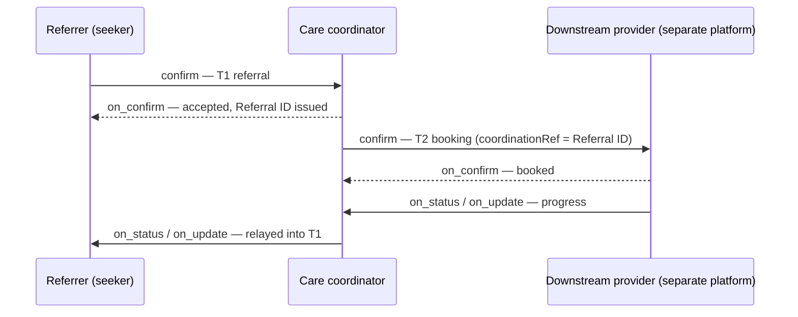

# Coordination model

This page describes **how** Sygnal coordinates care between independent platforms. It covers the transaction pattern that all the [use cases](../use-cases/README.md) follow, and the schemas they reuse.

## Transitions: handoffs of responsibility

The unit of coordination is a **transition**: one party hands responsibility for a next step to another. A referral, a transfer, an enrolment into routine care, a downward field task and an escalation to a higher-level facility are all transitions.

Sygnal does **not** invent new verbs for transitions. Beckn Protocol v2 already models a commitment between a seeker and a provider as a **contract**, with a complete lifecycle:

| Beckn action | Role in a transition | When it is used |
|---|---|---|
| `discover` / `on_discover` | Find a suitable receiver among candidates | **Matched** transitions only, where the receiver is not known in advance |
| `select` / `on_select` | Choose a specific offer | Matched transitions with a real choice |
| `init` / `on_init` | Agree binding terms: consent, SLA, responsible party | **Negotiated** transitions |
| `confirm` / `on_confirm` | Place the handoff and create the contract | **Every** transition |
| `status` / `on_status` | Observe current state; unsolicited pushes are allowed | Progress monitoring |
| `update` / `on_update` | Change and notify the shared contract, for example attended or outcome received | Delivery notifications, outcomes, reassignments |
| `cancel` / `on_cancel` | Withdraw or decline after acceptance | Cancellations |

Acceptance, attendance, no-show and completion are **states** on the contract, not verbs. This follows FHIR's own rule: "verbs encode intent; state is data". It also means every Beckn gateway, validator and software development kit (SDK) works without changes. In Sygnal terms, a **CareTransition** is a *profile* of the Beckn contract: a named use of it for health handoffs, with a restricted lifecycle. See [Transitions on Beckn](../specification/transitions-on-beckn.md).

## The two-transaction referral

A referral is modelled as a coordination contract (**T1**) held by a **care coordinator**, optionally followed by a downstream booking (**T2**).

* **T1, coordination.** The referrer is the seeker and the care coordinator is the provider. The contract carries a `HealthReferral` (or the generic `ServiceCoordination` for non-clinical tasks). The coordination id issued at `on_confirm` is the **Referral ID**.
* **T2, booking.** The coordinator, now acting as seeker, books the downstream provider. The T2 contract is a `HealthContract` whose `coordinationRef` carries the Referral ID. The T2 contract id is recorded as T1's `targetBookingRef`.

Whether T2 appears on the network depends on where the downstream provider runs:

| Downstream provider | Hops on the network | Escalation link |
|---|---|---|
| Runs on the coordinator's own platform | T1 only | `targetBookingRef` points to an internal reference |
| Runs on a separate platform | T1 + T2 | `targetBookingRef` points to the T2 contract id |

Escalation is therefore always the referral's **downstream target**. It is never a new referral. It also adds no new "escalated" lifecycle state: an existing state such as `BOOKING_CONFIRMED` shows that the downstream target is booked. One Referral ID covers the whole episode. The original referrer sees downstream progress because the coordinator relays T2 status into T1. See [UC1](../use-cases/uc1-upward-fever-referral.md) (internal) and [UC4](../use-cases/uc4-separate-system-escalation.md) (separate platform).

## Two ways a flow can vary

**Directed or matched?**

* **Directed:** the receiver is known, for example the clinical coordinator for a catchment. Discovery is skipped and the flow starts at `select` or `confirm`.
* **Matched:** the seeker must first find a suitable counterpart, so the flow starts at `discover` against the [Discovery Service](../components/discovery-service.md).

**Unconditional or negotiated?**

* **Unconditional:** no terms to agree, so go straight to `confirm`.
* **Negotiated:** consent, an SLA or other conditions must be set, so `init` precedes `confirm`.

## Direction is per transaction

The same two participants can transact in both directions, and their roles are set per transaction:

* **Upward** (for example, campaign to clinical): a clinical trigger observed in the field is referred into a clinical platform.
* **Downward** (for example, clinical to campaign): a field task such as checks or data collection is contracted to campaign field capacity.

## Records are a separate layer

Matching people and households across platforms is a **records-layer** task. An example is finding that the child in front of a campaign worker already has a clinical record. It is a real-time lookup in the identity or records infrastructure at the point of care. Sygnal carries coordination intent and state, not health records. For what a handoff itself needs, such as a referral note:

* **Where a records layer exists**, the referral carries a **pointer** to the note or record (credential-scoped, with a hash), and the receiver fetches it through the records layer, with consent. This is the recommended approach.
* **Coordination-specific information**, such as the referral note itself, **may travel with the peer-to-peer handoff** between the two parties. Encrypting the payload to the receiver's key, on top of TLS (standard transport encryption), is recommended, as the network's policy defines.
* **Health records beyond what the referral needs** should be shared outside the Sygnal network, over the records layer.

See [What may travel peer to peer](privacy-and-data-minimisation.md#what-may-travel-peer-to-peer).

## Schemas: reuse first

The peer-to-peer core reuses existing Beckn health and service schema packs, referenced by `@context` URL:

* `HealthReferral` / `ServiceCoordination`: the referral or coordination contract;
* `lifecycleState`: the referral state machine;
* `notificationRoster`: lets a coordinator loop in observers, such as a household's routine community health worker;
* the in-band `deviation` field, the credential-scoped `referralNote` pointer, and `consent`.

Sygnal adds its own schemas only where Beckn has a real gap: deviations raised beyond the two parties, coordination events, policies, shared plans and signals. These are defined in the [Sygnal APIs](../specification/apis/README.md). Community-health vocabulary that the upstream code lists don't yet cover is added as [coded values](../specification/coded-values.md), not as schema changes.

**Not only clinical, and not instead of FHIR.** Sygnal's schemas are OpenAPI definitions whose messages carry JSON-LD (`@context` and `@type`). This keeps the core open to any kind of service: clinical care, wider health services such as community health workers, and non-health services a patient may need, such as transport or accommodation, each described by its own schema pack. Platforms that use FHIR can map to Sygnal at the edge, and FHIR-aligned attributes can travel inside schema packs where a network needs them. Both approaches are being explored; see [Status and roadmap](../roadmap.md).

## Who talks to whom

Every message on the wire goes from one sender to one receiver. What differs is who the two parties are, and whether the exchange is a seeker–provider commitment. There are three shapes:

| Shape | What | Carried by |
|---|---|---|
| **Peer to peer** | Handoffs between the two parties to a transition: placing, accepting, updating and closing a referral or task; in-band deviations between them | Beckn verbs (`discover` to `cancel`) |
| **Among participants, possibly many** | Shared care plans across concurrent providers: one plan, any number of subscribers, from two upwards | `plan/sync`, delivered to each participant in turn |
| **Edge ↔ network** | Deviations and escalations up to the Deviation & Escalation Platform; coordination events up to Network Intelligence; advisory nudges (signals) down to edges; coordination policy down from governance | `deviation/flag`, `event/report`, `signal/emit`, `policy/update` |

Handoffs are seeker–provider commitments, so they reuse Beckn's contract. Shared plans, observation and governance don't fit a seeker–provider contract, and they are often one-to-many. So they use Sygnal's APIs instead. Only the peer-to-peer shape may carry information about a patient. Everything that reaches the network is coordination metadata (see [Privacy and data minimisation](privacy-and-data-minimisation.md)).
