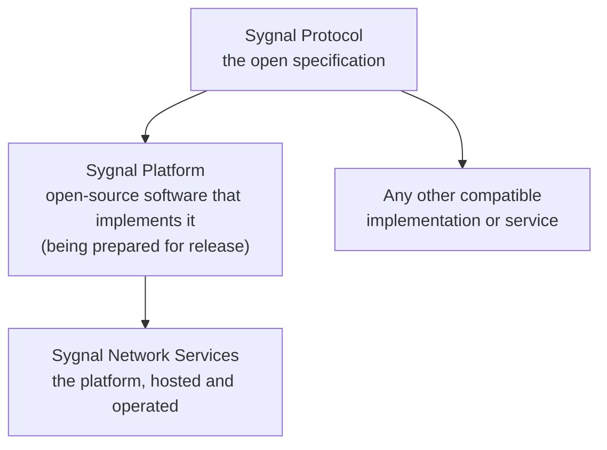

# Protocol, platform and services

The name Sygnal covers three distinct things. Each one builds on the one before, and a network can use as much or as little of each as it likes.

| | What it is | Who it is for | Licence or terms |
|---|---|---|---|
| **Sygnal Protocol** | The open specification: coordination APIs, schemas, code lists, conventions and the trust profile. It defines what any compatible platform or service must do. | Anyone building a platform, adapter or service that takes part in a Sygnal network | [CC BY-SA 4.0](https://creativecommons.org/licenses/by-sa/4.0/) |
| **Sygnal Platform** | Reference software that implements the protocol: the Edge Adapter and the network enablement components. It will be released as open source, so anyone can run it. | Health systems and operators who want to run a network, or a part of one, themselves | Open source, being prepared for release (see below) |
| **Sygnal Network Services** | The platform's shared components run as hosted services, so a network can start without operating them itself. | Networks that want to lower the cost and effort of adoption | Service terms to be published |

**The protocol is what matters for interoperability.** Platform and services are conveniences built on it. A participant that implements the protocol correctly can work with any other, whichever software or services either of them uses.

## How each component fits

| Component | Protocol | Platform | Network Services (hosted) |
|---|---|---|---|
| [Edge Adapter](../components/edge-adapter.md) | Beckn transport and trust; Sygnal APIs and conventions | Built on open-source Beckn ONIX; Sygnal edition being prepared for release | Not hosted: runs beside each platform. A hosting partner may run it on a platform's behalf. |
| [Network Registry](../components/network-registry.md) | The DeDi directory protocol, plus Sygnal roles and membership | No Sygnal registry software (see below) | [dedi.global](https://dedi.global) is the default registry service |
| [Discovery Service](../components/discovery-service.md) | Beckn `discover` / `on_discover` and catalogue publishing | Beckn's open-source discovery service ([beckn-discovr](https://github.com/beckn/beckn-discovr)), used as published | A Sygnal-operated discovery instance |
| [Policy Manager](../components/policy-manager.md) | `policy/update`, `policy/get`, the `CoordinationPolicy` format | Reference service (planned) | Planned |
| [Deviation & Escalation Platform](../components/deviation-and-escalation.md) | `deviation/flag`, `deviation/get` | Reference service (planned) | Basic receiver on the Sygnal Sandbox |
| [Network Intelligence](../components/network-intelligence.md) | `event/report`, network telemetry, `signal/emit` | Reporting service and dashboards, being prepared for release | Reporting service and dashboards on the Sygnal Sandbox |

### What is open today

The Sygnal Platform's own code isn't published yet. The software behind the Sygnal Sandbox is being hardened, documented and licensed, and will be released component by component as each one is ready for others to run. See [Status and roadmap](../roadmap.md).

What is already open:

* **the protocol:** the specification, code lists, conventions and trust profile, with an automated validator;
* **the reference flows:** runnable examples for every use case;
* **the adapter configuration:** the [ONIX configuration](https://github.com/Medtronic-LABS/sygnal/tree/main/adapter-config) that connects an adapter to a network's telemetry and dashboards, with the allow-list that keeps payload content at the edge;
* **the open-source foundations the platform builds on:** [Beckn ONIX](https://github.com/beckn/beckn-onix) for the Edge Adapter, and Beckn's [discovery service](https://github.com/beckn/beckn-discovr), which Sygnal runs as published.

### What a platform gets with ONIX and the specification alone

A platform can join a Sygnal network today with Beckn ONIX and the specification. That gives it the **peer-to-peer core**: signed handoffs with other participants, matched handoffs through discovery, and deviations sent directly between the two parties, within their own message exchange.

It does **not** give it the coordination services that make Sygnal more than a set of Beckn transactions. Those come from the Sygnal Platform:

* deviation tracking, dispositions and escalation ladders;
* monitoring handoffs against SLAs (service-level agreements);
* signed coordination policies, distributed and enforced at the edge;
* network intelligence: dashboards, patterns and advisory signals.

A platform doesn't have to wait for the Sygnal Platform's open-source release to use them. It can use them today through **Sygnal Network Services**, which are being enhanced and will be released as open source as part of the Sygnal Platform. Because every service implements the open protocol, a network that starts on the hosted services can later run the same services itself.

### The registry: a protocol, with a hosted service

The registry has an open protocol and a hosted service, but no Sygnal software is planned for it yet. The directory follows the open [DeDi protocol](https://github.com/LF-Decentralized-Trust-labs/decentralized-directory-protocol). Sygnal Network Services use [dedi.global](https://dedi.global) as the default registry service, but dedi.global's own software is not open source.

A network that cannot or does not want to use dedi.global, for example because it must host its directory in its own jurisdiction, has two routes:

* **run its own DeDi-compliant registry**, built to the open protocol; or
* **use an open-source Sygnal registry**, which Sygnal may build if networks need one. See [Status and roadmap](../roadmap.md).

Because the directory protocol is open, records stay portable between registries.

## Why the hosted services are safe to use

The shared services sit on the **control plane**. They are designed so that a network can rely on them without handing over patient data:

* **No patient data.** The control plane never carries personal or clinical data. Handoffs with patient context travel peer to peer, between the two parties. The services receive coordination metadata only, and only the fields that each network's policy allows. The edge enforces this before anything leaves it. The one exception is a governed notifiable-condition report, which a network has to switch on explicitly. See [Privacy and data minimisation](privacy-and-data-minimisation.md).
* **No special powers.** The operator registers and signs like any other participant. Every edge verifies its policies and signals. There is no privileged channel. See [Trust and security](trust-and-security.md).
* **Observe and signal, never decide.** The services can flag, escalate and advise. They can't block, reroute or override a handoff.
* **Care continues without them.** If a service is unavailable, peer-to-peer coordination continues, and edges queue what they would have reported.
* **No lock-in.** Each service implements the open protocol. A network can replace any of them with its own implementation, or with the platform software once released, without its participants changing their integration.

## Why they are convenient

* **Start small.** A network can begin with two platforms and an adapter each, and leave the shared services to the operator.
* **Fewer things to run.** Registry, discovery, deviation tracking and reporting come ready to use, along with dashboards.
* **A path to self-hosting.** When a health system is ready, it can bring any service in house, one at a time.

## Who operates Sygnal Network Services

Sygnal Network Services are operated by **Medtronic LABS** today. The operator may change as network governance develops; see [Network governance](../governance/README.md).


**Getting started.** Sygnal Network Services are available today as the [Sygnal Sandbox](../build/sandbox.md), an open test network for trying out care coordination with test data only. Production access opens network by network: once a network has tested in the sandbox and is ready to go live, production use is agreed with it, including hosting, data handling, availability and support.

