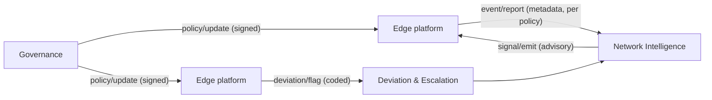

# Reporting and signals

Sygnal gives the network visibility through **two complementary reporting mechanisms**. It answers through **advisory signals**.

## Mechanism 1: counter-party deviation reporting (trust)

This is the basis of trust in the network, described in [Deviations and escalation](deviations-and-escalation.md). It is **silent by default**: nothing reaches the network services while handoffs go as expected. Only deviations escalate, raised by the party that was waiting.

## Mechanism 2: policy-based event reporting (observation)

Some parties need to **know** about coordination activity without being a counter-party to any single handoff:

* a programme manager who needs referral completion rates and time to acceptance by district;
* a primary-care facility that needs to know a campaign has started in its catchment;
* a public-health authority that must be notified of certain conditions.

**`sygnal/event/report`** serves these needs. The edge sends `CoordinationEvent`s to the network as the active **reporting policy** permits. The policy is a dial that governance sets:

| Setting | What leaves the edge | Typical use |
|---|---|---|
| **Aggregate** (the usual setting) | Counts per period and area, using metric codes the policy defines. No identifiers. | Routine coordination: referrals placed, accepted, completed |
| **Individual, notifiable only** | For a named set of notifiable conditions, a bounded, allow-listed set of fields with a stated legal basis, plus aggregates for everything else | Notifiable disease surveillance |

The edge emits the same events regardless of the setting. The policy decides what leaves the edge, and **the edge enforces it** before anything is sent. See [Privacy and data minimisation](privacy-and-data-minimisation.md).

Event types include `TRANSITION_PLACED`, `TRANSITION_ACCEPTED`, `TRANSITION_DECLINED`, `TRANSITION_COMPLETED`, `DELIVERY_RECORDED`, `DEVIATION_RAISED`, `COVERAGE_REPORTED`, `SYNDROMIC_SIGNAL` and `NOTIFIABLE_CASE`.

## Report in, signal out

`event/report` is **fire-and-forget**: the edge sends it and gets no business reply. The signed transport acknowledgement proves receipt. When the network has something to say, it says it with a **`sygnal/signal/emit`** to the affected edge:

| Signal | Meaning |
|---|---|
| `FOLLOW_UP_DUE` | An expected follow-up hasn't been recorded |
| `UNACKNOWLEDGED_REFERRAL` | A referral was placed but never accepted |
| `SLA_BREACH` | A coordination SLA was missed |
| `COVERAGE_GAP` | Coverage metadata shows people reached by no programme, or areas missed |
| `OUTBREAK_SUSPECTED` | A pattern in syndromic or notifiable signals crossed a threshold |

Every signal states its `basis` (what was observed) and may carry a `recommendedAction`. That recommendation is **advisory only**. The receiving platform, and the people using it, decide what to do. This one-way pattern keeps the centre thin: reports come in, signals go out, and neither side waits on a live reply.

## Two channels: coordination events and network telemetry

Sygnal deliberately separates two kinds of reporting:

| | Coordination events | Network telemetry |
|---|---|---|
| **What** | Coordination semantics: handoffs placed, accepted or completed; coverage; notifiable cases | Operational facts about the exchanges themselves: message counts, latencies, ACK/NACK, timeouts, SLA breaches |
| **How** | `sygnal/event/report`, signed | The network telemetry channel (OpenTelemetry/OTLP in the reference edge adapter) |
| **Governed by** | The policy's `ReportingSection` | The policy's `InstrumentationSection` |
| **Never** | Payload content beyond the allow-list | Payload content of any kind |

Telemetry has four levels: `OFF` (liveness only), `AGGREGATE` (counts and latencies per action, participant and window; the usual setting), `EXCEPTIONS` (aggregate plus one record per NACK, timeout or SLA breach), and `PER_TRANSACTION`. `PER_TRANSACTION` is for debugging only. It is allowed only on networks declared **non-production**, only until a stated expiry, and only with a fixed list of header-level fields.

## From report to contract

Some reports may later need to become commitments. A campaign signal to a facility is awareness only today: the facility needs to *know*. If the relationship becomes a mutual commitment, where the facility formally accepts responsibility for the households a campaign reaches, the same signal can become a standing **coordination contract**. The parties set it up once with `init`/`confirm`, then send per-household reconciliation as updates. The edge's event emission doesn't change; only the policy and the contract do.
