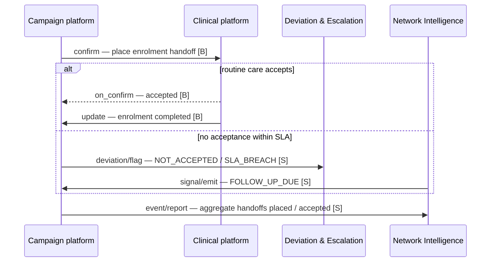
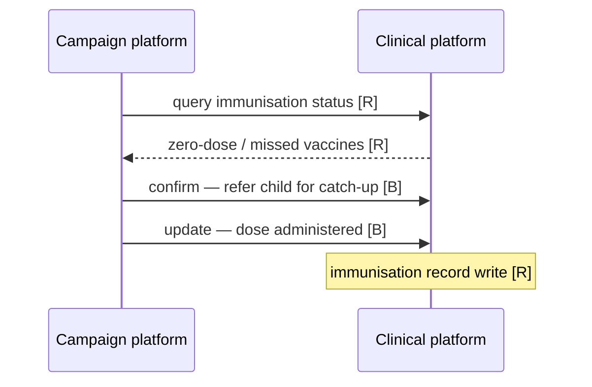
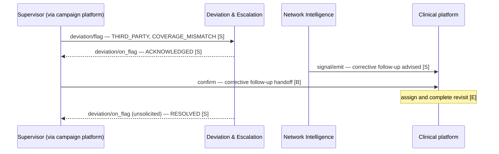
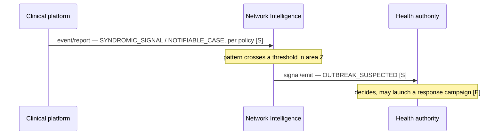
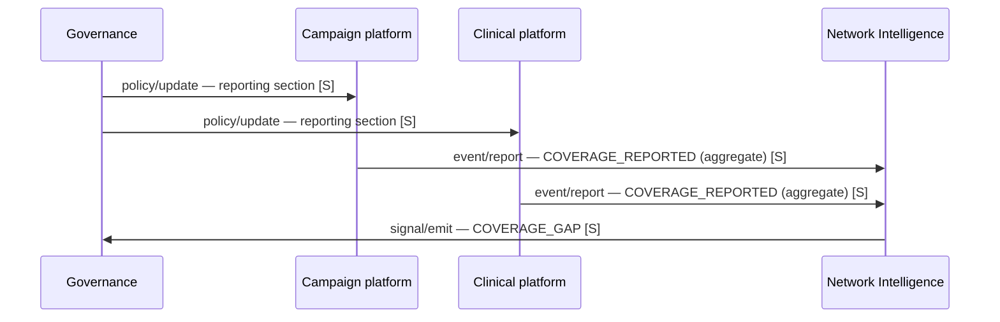

# Coordination patterns

Beyond the four worked use cases, the same two kinds of platform (a health campaign platform and a clinical platform) give rise to six recurring coordination patterns. Together they show where Beckn handoffs are enough, and where Sygnal's own APIs are needed.

**Legend:** **[B]** reused Beckn verb · **[S]** Sygnal API · **[R]** records layer (below Sygnal) · **[E]** inside an edge platform (out of scope)

## 1. Campaign to routine-care conversion

When a campaign reaches a household, the household should be enrolled in routine care. Loss to follow-up shows up as the **absence** of the counter-party's acceptance.

## 2. Cross-programme coordination

A malaria campaign worker finds a child who missed vaccinations. Checking immunisation status and writing the dose record are **records-layer** operations. Sygnal owns only the handoff to the immunisation programme and its notification.

## 3. Supervisor deviation to corrective follow-up

A supervisor's spot-check finds that a household recorded as covered was actually missed. This is the main example of a third-party deviation.

## 4. Delivery attestation (planned)

A health worker delivers a commodity to a household. The household is not a network participant, so there is no counter-party to co-sign. Proving the delivery needs a first-party **attestation** (a statement by the delivering side that it happened), tied to an obligation, such as a campaign checklist item. This is the one pattern that needs the planned `attestation/attest` API. Today only the **mismatch** path (`deviation/flag`, `ATTESTATION_MISMATCH`) is available. Payment for the delivery stays inside the campaign platform; Sygnal is not a payment rail.

## 5. Outbreak signalling

Clinical platforms report syndromic or notifiable signals under policy. Network Intelligence spots a cluster and signals the health authority, **which decides** on the response.

## 6. Coverage observation

"Which areas are reached by many programmes, and which are missed by all?" Aggregate coordination metadata can answer this, per period and area, at the level of detail that governance sets. A per-household answer would need pseudonymous subject references and a keyed-hash scheme. That is an [open question](../reference/open-questions.md).

## Summary

| Pattern | Beckn handoff | Sygnal APIs |
|---|---|---|
| 1. Campaign → routine | ✓ | `deviation/flag`, `event/report`, `signal/emit` |
| 2. Cross-programme | ✓ | `event/report` (optional) |
| 3. Supervisor deviation | Corrective handoff | `deviation/flag` (third party), `signal/emit` |
| 4. Delivery attestation | — | `attestation/attest` (planned), `deviation/flag` |
| 5. Outbreak signalling | — | `event/report`, `signal/emit` |
| 6. Coverage observation | — | `policy/update`, `event/report`, `signal/emit` |

## Where Sygnal is **not** the right tool

* Peer-to-peer device sync **within** one platform;
* supply-chain and inventory logistics;
* payment disbursement;
* microplanning and campaign configuration;
* clinical-data queries and record writes, which belong to the records layer;
* a single, bilateral integration between two platforms with no wider network. A direct integration is simpler there. Sygnal becomes worth it at the second programme and the third platform. That is when many independently run edges need trust, closed loops and observation across them.
