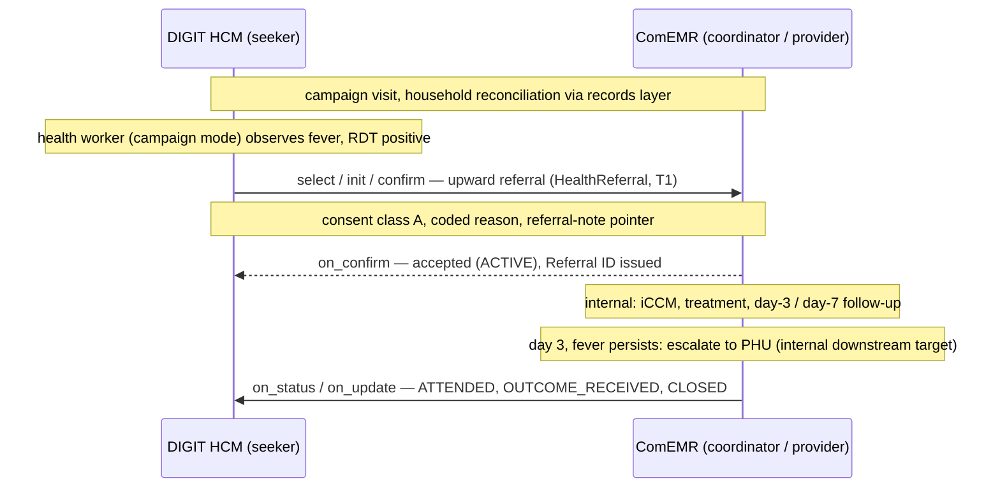

# UC1 — Upward fever referral

| | |
|---|---|
| **Status** | Draft |
| **Direction** | Upward (campaign → clinical) |
| **Transactions** | T1 only (single on-network hop) |
| **Contract** | `HealthReferral` (v2.1) |
| **Consent** | Class A |
| **Reference flow** | [`reference-flows/UC1-upward-fever-referral/`](https://github.com/Medtronic-LABS/sygnal/tree/main/reference-flows/UC1-upward-fever-referral) |

## Actors

| Party | Role on the network | Platform |
|---|---|---|
| Community health worker (campaign mode) | Referrer | DIGIT HCM, as **seeker** |
| ComEMR | Care coordinator **and** provider | ComEMR, as **provider** |
| Clinical-mode health worker; peripheral health unit (PHU) | Internal targets of ComEMR | ComEMR |

## Trigger

During a bednet campaign visit, a community health worker observes fever in a child, and a rapid diagnostic test (RDT) is positive for malaria. This is a clinical trigger found during a campaign visit. A check against the records and identity layer has already found the child's ComEMR record on the same device. That check is a direct, real-time (synchronous) lookup; the coordination network is not involved.

## What crosses the network

DIGIT HCM refers the child into ComEMR (**T1**). ComEMR accepts, then routes internally to a clinical-mode health worker for integrated community case management (iCCM): RDT confirmation, treatment, and day-3 and day-7 follow-up. If fever persists at day 3, ComEMR escalates to the PHU.

Because the PHU also runs ComEMR here, the escalation is **internal**. It is recorded as the referral's downstream target, using `targetBookingRef` (an opaque internal reference that other parties do not interpret). It is **not** a new referral and **not** a second on-network transaction. The separate-platform case is [UC4](uc4-separate-system-escalation.md).

DIGIT HCM stays informed of the outcome through T1 `status` and `update`.

## Design notes

* **Directed.** ComEMR is the known clinical coordinator for the area, so the flow skips discovery and starts at `select`.
* **Single on-network hop.** ComEMR is both coordinator and provider.
* **Escalation as downstream target.** See [The two-transaction referral](../concepts/coordination-model.md#the-two-transaction-referral).
* **In-band deviation.** A `NO_SHOW` branch shows a deviation carried in the referral's built-in `deviation` field between the two parties.
* **No consideration block (payment terms).** This is public-health coordination with no fee.

**Lifecycle states exercised:** `DRAFT → ACTIVE → ATTENDED → BOOKING_CONFIRMED → OUTCOME_RECEIVED → CLOSED`, plus a `NO_SHOW` deviation branch.

## Consent

Class **A**: explicit consent, mediated by the health worker. It is captured at the field observation and carried in the referral (`consent.consentClass = A`, with `mediatorCredentialRef` set to the worker's credential).

## Where the Sygnal APIs come in

* **SLA.** The policy can set an acceptance SLA (service-level agreement: a time limit for accepting) for this transition type. If ComEMR doesn't accept in time, DIGIT HCM raises `deviation/flag` (`SLA_BREACH`), because it is the expecting party.
* **Reporting.** Both platforms report aggregate counts (referrals placed, accepted, completed) under the district's policy. One use is to close the loop: malaria cases by area feed back into campaign microplanning.
* **Signals.** Network Intelligence can send `UNACKNOWLEDGED_REFERRAL` or `FOLLOW_UP_DUE`.

## Scope

**In scope:** the peer-to-peer referral lifecycle over `HealthReferral`, and an in-band coded deviation.

**Out of scope:** the clinical work itself, which is internal to ComEMR; records-layer data sync; policy-governed reporting.

## Outcome

The child is treated. ComEMR hands an outcome note back to DIGIT HCM as a credential-scoped pointer. The clinical data stays in the records layer. The referral is `CLOSED`.

## Notes and gaps

* `targetCriteria.specialty` / `subSpecialty` use `PAEDIATRICS` / `ICCM`, which are additions in the network's [code lists](../specification/coded-values.md).
