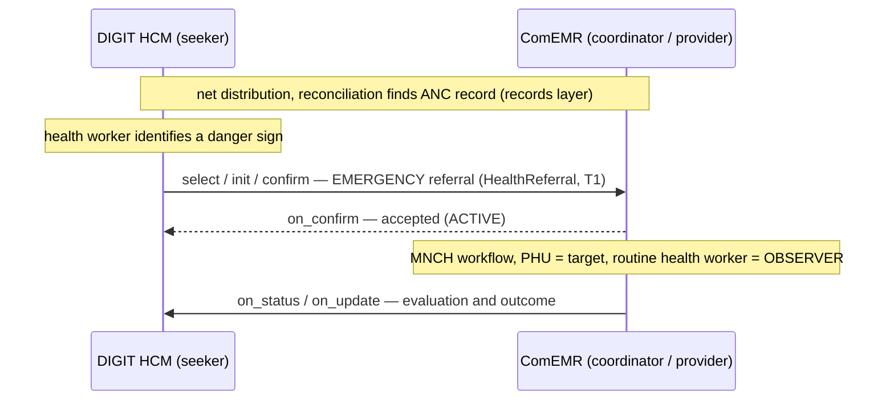

# UC2 — Upward MNCH danger-sign referral

| | |
|---|---|
| **Status** | Draft |
| **Direction** | Upward (campaign → clinical) |
| **Transactions** | T1 only (single on-network hop) |
| **Contract** | `HealthReferral` (v2.1) |
| **Consent** | Class A |
| **Reference flow** | [`reference-flows/UC2-upward-mnch-danger-sign/`](https://github.com/Medtronic-LABS/sygnal/tree/main/reference-flows/UC2-upward-mnch-danger-sign) |

## Actors

| Party | Role on the network | Platform |
|---|---|---|
| Community health worker (campaign mode) | Referrer | DIGIT HCM, as seeker |
| ComEMR | Care coordinator **and** provider | ComEMR, as provider |
| Peripheral health unit (PHU) | Internal target of ComEMR | ComEMR |
| The household's routine health worker | **Observer** on the notification roster | — |

## Trigger

During net distribution, the health worker identifies a maternal, newborn and child health (MNCH) danger sign in a pregnant mother. A check against the records layer finds her antenatal care (ANC) record. The danger sign requires an **emergency** referral to the PHU.

## What crosses the network

DIGIT HCM raises an emergency referral to ComEMR (**T1**). ComEMR runs its MNCH workflow with the PHU as the target. Crucially, it also brings in the household's **routine health worker**, who can help with transport and follow-up.

ComEMR handles this routing to two parties **internally**, using the referral's notification roster: the routine health worker is listed with `partyRole: OBSERVER` and `notificationScope: LIFECYCLE_ONLY`. The only on-network transaction is still T1.

## What's different from UC1

Only two things: `clinicalUrgencyTier = EMERGENCY`, and the `notificationRoster` carries an extra `OBSERVER` entry. Consent basis and topology are the same as [UC1](uc1-upward-fever-referral.md). The lifecycle differs slightly: the PHU is notified as the target rather than booked.

**Lifecycle states exercised:** `DRAFT → ACTIVE → TARGET_NOTIFIED → ATTENDED → OUTCOME_RECEIVED → CLOSED`, plus a `PATIENT_CANCELLED` deviation branch for when the family declines transfer.

## Where the Sygnal APIs come in

* **Emergency SLA.** An SLA (service-level agreement) sets time limits. Emergency urgency typically maps to a short acceptance window in the policy's `SlaSection`. If the window is breached, the referrer raises it through `deviation/flag`.
* **Referral-response-time visibility.** Aggregate reporting shows programme managers the time to acceptance for emergency referrals, by area.

## Scope

**In scope:** the T1 referral lifecycle, with the observer roster entry shown at `confirm`.

**Out of scope:** the MNCH clinical workflow, which is internal to ComEMR; records-layer sync; policy-governed reporting.

## Notes and gaps

* `specialty` / `subSpecialty` use `OBSTETRICS` / `MNCH`, which are additions in the network's [code lists](../specification/coded-values.md).
