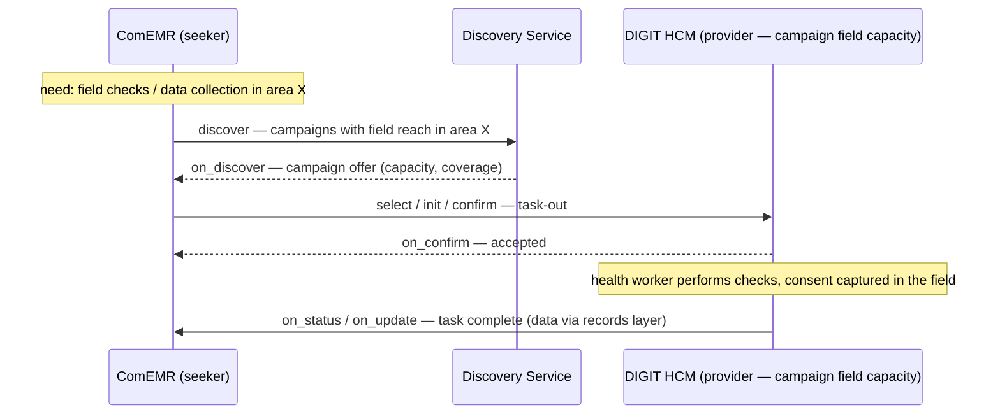

# UC3 — Downward task-out

| | |
|---|---|
| **Status** | Draft |
| **Direction** | Downward (clinical → campaign) |
| **Transactions** | One matched transaction (discover first) |
| **Contract** | Generic `ServiceCoordination` (v2.1) |
| **Consent** | Class A (self-authored extension; see gaps) |
| **Reference flow** | [`reference-flows/UC3-downward-task-out/`](https://github.com/Medtronic-LABS/sygnal/tree/main/reference-flows/UC3-downward-task-out) |

## Actors

| Party | Role on the network | Platform |
|---|---|---|
| ComEMR | Requester | ComEMR, as **seeker** |
| DIGIT HCM | Provider of campaign field capacity | DIGIT HCM, as **provider** |
| Community health worker (campaign mode) | Field worker | DIGIT HCM |

This is the reverse direction of UC1 and UC2. The same two participants take part, but ComEMR is now the seeker. Roles are per transaction.

## Trigger

ComEMR needs field checks or data collection for clinical or routine reasons. A campaign-mode health worker who is already visiting households is best placed to do this. For example, the worker can verify a cohort (a defined group of patients) or collect follow-up data during an active campaign.

## What crosses the network

ComEMR must first find a suitable campaign, so this is a **matched** transaction: `discover → on_discover → select → init → confirm → on_confirm`, then `status` and `update`. A campaign-mode health worker performs the checks and the task completes.

## Why the generic contract

A field-check or data-collection task has no clinical specialty, urgency tier or clinical referral note. The clinical fields of `HealthReferral` would sit empty. So this use case uses the generic `ServiceCoordination` instead (the base that `HealthReferral` extends), with `targetCriteria.serviceCategory = FIELD_DATA_COLLECTION`. `HealthReferral` applies only where a downward task is itself a clinical, per-patient check.

## Data path

The **collected data travels through the records layer**, not the coordination network. Only task metadata (details about the task) and its completion state travel on the network.

**Lifecycle states exercised:** `DRAFT → ACTIVE → ATTENDED → CLOSED`.

## Where the Sygnal APIs come in

* **Discovery.** In a full network, the `discover` call goes to the [Discovery Service](../components/discovery-service.md), which returns campaign offers crawled from published catalogues.
* **SLA.** The SLA (service-level agreement) sets the agreed time window. If the task isn't completed within it, ComEMR can raise `deviation/flag`, because it is the expecting party.

## Consent and gaps

Class **A**: the health worker mediates consent and captures it in the field. This is the same basis as the upward referrals.


**Schema gap.** The generic `ServiceCoordination` pack has **no consent field**; consent exists only in the health pack. The reference flow carries class-A consent as a **self-authored extension** on the generic contract attributes. See [Consent](../concepts/consent.md#known-gap-consent-on-the-generic-contract).

