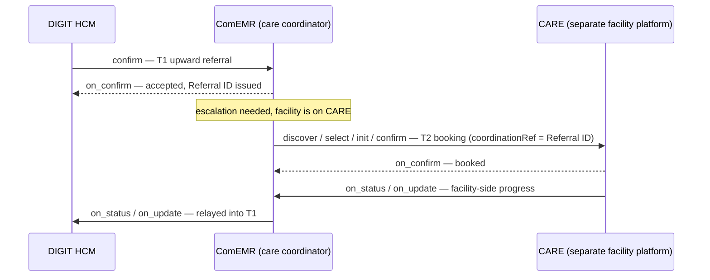

# UC4 — Escalation to a separate system

| | |
|---|---|
| **Status** | Draft |
| **Direction** | Upward, with a downstream second hop |
| **Transactions** | T1 (DIGIT HCM → ComEMR) + T2 (ComEMR → CARE) |
| **Contracts** | T1 `HealthReferral`; T2 `HealthContract` booking |
| **Consent** | Class A |
| **Reference flow** | [`reference-flows/UC4-separate-system-escalation/`](https://github.com/Medtronic-LABS/sygnal/tree/main/reference-flows/UC4-separate-system-escalation) |

## Actors

| Party | Role on the network | Platform |
|---|---|---|
| Community health worker (campaign mode) | Referrer | DIGIT HCM (seeker in T1) |
| ComEMR | Care coordinator: provider in T1, **seeker in T2** | ComEMR |
| CARE | Escalation facility (PHU) | CARE, a separate hospital information system (provider in T2) |

## Trigger

The same upward fever referral as [UC1](uc1-upward-fever-referral.md), except that the escalation facility runs a **separate platform** (CARE) rather than ComEMR. UC1's internal escalation therefore becomes a genuine second on-network transaction.

## What crosses the network

* **T1, DIGIT HCM → ComEMR:** the upward referral (`HealthReferral`). The coordination id issued at `on_confirm` is the **Referral ID**.
* **T2, ComEMR → CARE:** ComEMR, already the care coordinator, discovers and books the facility on CARE as a `HealthContract` booking. Its `coordinationRef` carries the T1 Referral ID, and the T2 contract id becomes T1's `targetBookingRef`.
* **Status relay:** ComEMR relays CARE's T2 `on_status` / `on_update` messages into T1. This lets DIGIT HCM, the original referrer, see provider-side progress.

## Design notes

* **The same model as UC1, with a different link target.** In UC1, `targetBookingRef` is an internal reference. Here it is the T2 contract id. See [The two-transaction referral](../concepts/coordination-model.md#the-two-transaction-referral).
* **T2 is a booking** with `coordinationRef` back to the Referral ID. The referral note travels as a pointer to an input artefact. T2 is matched: ComEMR discovers CARE first.
* **The relay lives in the coordinator.** ComEMR translates T2 status into T1 status. No extra schema is needed; the same pack applies across both hops.
* **Critical cross-link.** `coordination_id_uc4` (the T1 Referral ID) and `booking_id_uc4` (the T2 booking id) must be identical across the T1, T2 and relay folders of the collection.

## Consent

Class **A**. Consent is established in T1, and T2 refers to it through `coordinationRef` and the referral note.

## Where the Sygnal APIs come in

* **SLA on both hops.** The policy can set separate SLA (service-level agreement) windows for T1 acceptance and T2 booking confirmation. Each hop's expecting party raises its own breach.
* **Signals.** An unacknowledged T2 booking can trigger an `UNACKNOWLEDGED_REFERRAL` signal to ComEMR, the coordinator.

## Scope

**In scope:** the T1 lifecycle, the T2 booking lifecycle, and the relay that chains T2 status into T1.

**Out of scope:** CARE's internal clinical workflow; records-layer data sync.

The reference collection has three folders: `T1 · Referral Coordination`, `T2 · PHU Booking on CARE`, and `Relay · CARE progress → T1 status chain`.
